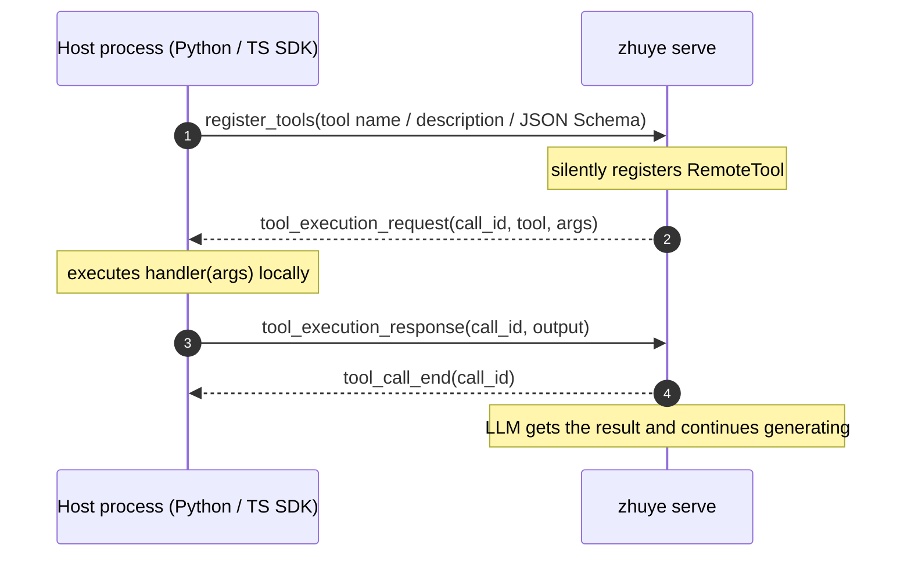

# SDK Integration Guide (Python / TypeScript)

<p align="center">  <a href="sdk.md">中文</a> · <b>English</b>  </p>

> Scripting projects can drive this framework in full without writing
> Rust: `zhuye serve` provides a persistent stdio JSONL session (one
> process = one resident AgentThread, multi-turn sharing in-memory
> state, with resume support), and the official SDKs wrap it with
> APIs that follow each language's idioms — **reasoning and
> orchestration live in the Rust engine; business logic stays in the
> host language**. The full command surface is in
> [cli.md](cli.md); wire protocol details are in
> [sdks/PROTOCOL.md](../sdks/PROTOCOL.md).

## Quick Start

The SDKs work by spawning a `zhuye serve` subprocess. When developing
from source, build the binary first:

```bash
cargo build -p zhuye-cli
ZHUYE_BIN="$PWD/target/debug/zhuye" ZHUYE_MODEL=mock python3 -c \
  "from zhuye import ZhuyeAgent; print(ZhuyeAgent.spawn().prompt('hello')); ..."
```

`ZHUYE_MODEL=mock` is the explicit offline model (no network, no API
key); for real model configuration see
[configuration.md](configuration.md).

## Three Usage Modes

| Mode | Entry point | Suitable for |
|------|-------------|--------------|
| headless single turn | `zhuye exec "..."` | scripts / CI: run one turn and exit, events as JSONL on stdout |
| persistent session (SDK) | `ZhuyeAgent.spawn()` | embedding into Python / TS products: multi-turn sharing, host tools, approval interaction |
| in-process library link | `Zhuye::builder(...)` (Rust) | the host itself is Rust; no subprocess needed |

## Cross-language Custom Tools

The most distinctive capability is **host-language tool registration**:
declare a Python / TS function as a tool (JSON Schema parameters);
when the LLM invokes it, the core dispatches
`tool_execution_request`, the SDK executes the handler locally and
sends the receipt back — the tool implementation never enters the
Rust process:



Timeout and error semantics: the receipt wait limit is controlled by
`ZHUYE_REMOTE_TOOL_TIMEOUT_SECS` (default 120s); when the handler
throws, the SDK should convert it into a text receipt with
`is_error=true` so the LLM sees the error instead of hanging. The
full wire protocol (handshake / approval / exit semantics) is in
[\`sdks/PROTOCOL.md\`](../sdks/PROTOCOL.md).

## Binary Resolution Order

Both SDKs share the same order, highest to lowest:

```
options.bin (explicitly passed via ZhuyeAgentOptions)
  → ZHUYE_BIN environment variable
  → bundled binary (Python: embedded in the platform wheel; TS: platform sub-package)
  → zhuye on PATH
```

Published installs (`pip install zhuye` / `npm install zhuye`) ship
the embedded binary and work out of the box; when developing from
this repository, point `options.bin` or `ZHUYE_BIN` at
`target/debug/zhuye`.

## Python

`sdks/python`: pure stdlib, zero dependencies, Python ≥ 3.10, ships
`py.typed`:

```python
from zhuye import ZhuyeAgent, ToolOutput, ContentBlock

agent = ZhuyeAgent.spawn()

def get_weather(args):
    return ToolOutput(
        content=[ContentBlock(type="text", text=f"{args['city']} 晴")],
        is_error=False, metadata={}, elapsed_ms=0,
    )

# Local function → tool the LLM can call
agent.register_tool("get_weather", "查询城市天气",
                    {"type": "object",
                     "properties": {"city": {"type": "string"}},
                     "required": ["city"]},
                    get_weather)

for ev in agent.submit("北京天气如何?"):        # blocking iterator, incremental events
    if ev["msg"]["type"] == "agent_message_delta":
        print(ev["msg"]["delta"], end="", flush=True)
    if ev["msg"]["type"] == "turn_complete":
        break
agent.close()
```

Public API (`sdks/python/zhuye/__init__.py`): `ZhuyeAgent`,
`ZhuyeAgentOptions`, `ToolHandler`, `ToolOutput`, `ContentBlock`,
`Op`, `Submission`, `Event`, `EventMsg`, `UnknownEventMsg`,
`RemoteToolSpec`. Main `ZhuyeAgent` methods: `spawn(options)` /
`register_tool` / `submit(text)` (blocking event iterator) /
`submit_op(op)` / `prompt(text)` (aggregated text) / `interrupt` /
`approve` / `next_global_event` / `close`.

## TypeScript

`sdks/typescript`: pure TS, zero runtime dependencies, Node ≥ 18, pure
ESM, ships `.d.ts`; the API mirrors the Python version:

```ts
import { ZhuyeAgent } from 'zhuye';

const agent = await ZhuyeAgent.spawn();
await agent.registerTool(
  'get_weather', '查询城市天气',
  { type: 'object', properties: { city: { type: 'string' } }, required: ['city'] },
  (args) => ({
    content: [{ type: 'text', text: `${args.city} 晴` }],
    is_error: false, metadata: {}, elapsed_ms: 0,
  }),
);

const text = await agent.prompt('北京天气如何?');   // aggregates incremental text
// or consume event by event:
for await (const ev of agent.submit('北京天气如何?')) {
  if (ev.msg.type === 'turn_complete') break;
}
await agent.close();
```

Main `ZhuyeAgent` methods: `spawn(options)` / `registerTool` /
`submit(text | op, opts)` (async event iterator) / `prompt` /
`interrupt` / `approve` / `nextGlobalEvent` / `close`, plus the
`childProcess` getter.

## Advanced Surface

Shared capabilities of both SDKs:

- `submit()` returns an event stream filtered by submission id —
  concurrent submissions of multiple turns don't interfere with each
  other (the serve-side core serializes the queue; events are routed
  by their own `id`);
- `interrupt()` interrupts the current turn (that turn ends with
  `turn_aborted`);
- `approve()` responds to an `approval_request` approval request
  (approve / deny + reason);
- the `plugins` option explicitly loads plugins — when passed, serve
  is started with `--plugin <id>`, **overriding** the config's
  `[plugins].enabled_plugins` (embedders enable precisely as needed,
  without reading the global switch); omitted / empty = keep
  config-driven behavior. Ids look like `name@marketplace` (local
  installs are `name@inline`). After startup, confirm via the
  `plugin_loaded` global event (read with `nextGlobalEvent` /
  `next_global_event`);
- unknown protocol event types degrade automatically — protocol v0 is
  frozen but new variants are allowed; the framework adding variants
  doesn't break the SDK;
- **side-channel queries (WP9)**:
  `submit_op({"type":"query_side_channels"})` →
  `side_channel_status` snapshot (channels array) +
  `submission_closed` to finish. The sibling `start_side_channel` /
  `cancel_side_channel` events (`side_channel_started` /
  `side_channel_finished`) pass through verbatim as additive
  variants. Locked down by four layers of tests: py/ts mock layer
  (sdks/*/tests) + real binary layer (tests/sdk-python K10 /
  tests/sdk-ts K10).
- **runtime rescan of the skills directory (v1.x)**:
  `submit_op({"type":"rescan_extensions", "skills": true})` →
  `extensions_rescanned` (skills count; the commands bit is always
  false). Used to make changes to the `.zhuye/skills` directory take
  effect without a restart; plugin injection and built-in packages are
  unaffected. Locked down by four layers of tests: py/ts mock layer
  (sdks/*/tests) + real binary layer (tests/sdk-python K14 /
  tests/sdk-ts K14) + capability coverage layer (tests/functional
  V11).

```python
# Load plugins on demand (if not installed, nothing is loaded at all, zero impact)
agent = ZhuyeAgent.spawn(ZhuyeAgentOptions(plugins=["demo@inline"]))
```

```ts
await ZhuyeAgent.spawn({ plugins: ['demo@inline'] });
```

## Protocol Overview

serve wire format: one `Submission` per stdin line, one `Event` per
stdout line, stderr is logging (does not pollute the event stream).
Type discriminators are snake_case.

- **Op (client → serve)**: 27 kinds — the core ones include
  `user_input`, `compact`, `interrupt`, `rewind`, `shutdown`,
  `tool_approval`, `steer`, `register_tools`,
  `tool_execution_response`, plus the plan / goal / permission /
  side-channel / guard-stats interaction families.
- **EventMsg (serve → client)**: 49 kinds — turn lifecycle
  (`turn_started` / `turn_complete` / `turn_aborted`), incremental
  streams (`agent_message_delta` / `thinking_delta`), tool calls
  (`tool_call_begin` / `tool_call_args_delta` / `tool_call_end` /
  `tool_execution_request`), approval and questioning
  (`approval_request` / `ask_user_question` / `permission_bubble`),
  orchestration (`subagent_progress` / `side_channel_*`),
  integrations (`mcp_server_started` / `lsp_server_failed` /
  `plan_ready` …).
- For the full field-level reference (including the JSON shape of
  each variant) see [sdks/PROTOCOL.md](../sdks/PROTOCOL.md).
- **Unknown event degradation**: the SDK passes unknown `type`s
  through verbatim as open types (not rewriting them into a fixed
  `"unknown"`); old SDKs against a new serve don't crash; your own
  event handling logic should still tolerate unknown `type`s.

## Offline Testing & Resume

```bash
# No API key, no network: built-in mock provider (ZHUYE_MOCK_SCRIPT can script each model reply)
ZHUYE_MODEL=mock ./scripts/sdk_smoke.sh   # runs both SDKs end-to-end against the real binary (requires a release build first)
```

Session resume (via the serve / SDK submission channel or the CLI):

| Method | CLI equivalent |
|--------|----------------|
| by thread id | `zhuye exec --resume <UUID>` |
| continue the most recent | `zhuye exec -c` |
| by ordinal (1-indexed, newest first) | `zhuye exec -r <N>` |

The three are mutually exclusive; when a prompt is also given, resume
takes precedence.

## Further Reading

| Document | Content |
|----------|---------|
| [sdks/PROTOCOL.md](../sdks/PROTOCOL.md) | serve wire protocol spec (handshake / tool execution flow / approval receipts / exit semantics); the basis for hand-written integrations in any language |
| [sdks/python/README.md](../sdks/python/README.md) | Python SDK: installation, full API, and the pytest suite |
| [sdks/typescript/README.md](../sdks/typescript/README.md) | TypeScript SDK: installation, full API, and npm test |
| [cli.md](cli.md) | Full CLI subcommand reference |
| [plugins.md](plugins.md) | Plugin usage (the SDK's `plugins` option is its entry point) |
