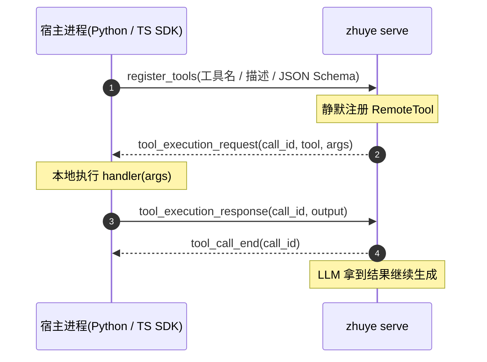

# SDK 接入指南(Python / TypeScript)

<p align="center">  <b>中文</b> · <a href="sdk.en.md">English</a>  </p>

> 脚本项目不需要写 Rust 也能完整驱动本框架:`zhuye serve` 提供常驻
> stdio JSONL 会话(一个进程 = 一个常驻 AgentThread,多轮共享内存状态,
> 支持 resume),官方 SDK 在其上封装出符合各自语言习惯的 API ——
> **推理与编排在 Rust 引擎,业务逻辑留在宿主语言**。
> 命令参数全貌见 [cli.md](cli.md);wire 协议细节见
> [sdks/PROTOCOL.md](../sdks/PROTOCOL.md)。

## 快速开始

SDK 通过 spawn `zhuye serve` 子进程工作。开发自源码时先编出二进制:

```bash
cargo build -p zhuye-cli
ZHUYE_BIN="$PWD/target/debug/zhuye" ZHUYE_MODEL=mock python3 -c \
  "from zhuye import ZhuyeAgent; print(ZhuyeAgent.spawn().prompt('hello')); ..."
```

`ZHUYE_MODEL=mock` 是显式离线模型(无网络、无 API key);真模型配置见
[configuration.md](configuration.md)。

## 三种用法总览

| 用法 | 入口 | 适用 |
|------|------|------|
| headless 单轮 | `zhuye exec "..."` | 脚本 / CI,跑一轮就退,事件 JSONL 走 stdout |
| 常驻会话(SDK) | `ZhuyeAgent.spawn()` | 嵌进 Python / TS 产品,多轮共享、宿主工具、审批交互 |
| 进程内库链接 | `Zhuye::builder(...)`(Rust) | 宿主就是 Rust,免子进程 |

## 跨语言自定义工具

最有特点的能力是**宿主语言工具注册**:把 Python / TS 函数声明成工具
(JSON Schema 参数),LLM 调用时 core 下发 `tool_execution_request`,
SDK 在本地执行 handler 并回执 —— 工具实现无需进 Rust 进程:



超时与错误语义:回执等待上限由 `ZHUYE_REMOTE_TOOL_TIMEOUT_SECS`
控制(默认 120s);handler 抛异常时 SDK 应转成 `is_error=true` 的文本
回执,让 LLM 看到错误而不是挂死。完整 wire 协议(握手 / 审批 / 退出
语义)见 [`sdks/PROTOCOL.md`](../sdks/PROTOCOL.md)。

## 二进制解析顺序

两套 SDK 一致,从高到低:

```
options.bin(ZhuyeAgentOptions 显式传入)
  → ZHUYE_BIN 环境变量
  → 包内二进制(Python: 平台 wheel 内嵌;TS: 平台子包)
  → PATH 上的 zhuye
```

已发布安装(`pip install zhuye` / `npm install zhuye`)自带内嵌二进制,
开箱即用;从本仓库开发时,用 `options.bin` 或 `ZHUYE_BIN` 指向
`target/debug/zhuye` 即可。

## Python

`sdks/python`,纯 stdlib 零依赖,Python ≥ 3.10,含 `py.typed`:

```python
from zhuye import ZhuyeAgent, ToolOutput, ContentBlock

agent = ZhuyeAgent.spawn()

def get_weather(args):
    return ToolOutput(
        content=[ContentBlock(type="text", text=f"{args['city']} 晴")],
        is_error=False, metadata={}, elapsed_ms=0,
    )

# 本地函数 → LLM 可调用的工具
agent.register_tool("get_weather", "查询城市天气",
                    {"type": "object",
                     "properties": {"city": {"type": "string"}},
                     "required": ["city"]},
                    get_weather)

for ev in agent.submit("北京天气如何?"):        # 阻塞式迭代器,增量事件
    if ev["msg"]["type"] == "agent_message_delta":
        print(ev["msg"]["delta"], end="", flush=True)
    if ev["msg"]["type"] == "turn_complete":
        break
agent.close()
```

公开 API(`sdks/python/zhuye/__init__.py`):`ZhuyeAgent`、
`ZhuyeAgentOptions`、`ToolHandler`、`ToolOutput`、`ContentBlock`、
`Op`、`Submission`、`Event`、`EventMsg`、`UnknownEventMsg`、
`RemoteToolSpec`。`ZhuyeAgent` 主要方法:`spawn(options)` /
`register_tool` / `submit(text)`(阻塞事件迭代器)/ `submit_op(op)` /
`prompt(text)`(聚合文本)/ `interrupt` / `approve` /
`next_global_event` / `close`。

## TypeScript

`sdks/typescript`,纯 TS 零运行时依赖,Node ≥ 18,纯 ESM,带 `.d.ts`,
API 与 Python 版同构:

```ts
import { ZhuyeAgent } from 'zhuye';

const agent = await ZhuyeAgent.spawn();
await agent.registerTool(
  'get_weather', '查询城市天气',
  { type: 'object', properties: { city: { type: 'string' } }, required: ['city'] },
  (args) => ({
    content: [{ type: 'text', text: `${args.city} 晴` }],
    is_error: false, metadata: {}, elapsed_ms: 0,
  }),
);

const text = await agent.prompt('北京天气如何?');   // 聚合增量文本
// 或逐事件消费:
for await (const ev of agent.submit('北京天气如何?')) {
  if (ev.msg.type === 'turn_complete') break;
}
await agent.close();
```

`ZhuyeAgent` 主要方法:`spawn(options)` / `registerTool` /
`submit(text | op, opts)`(异步事件迭代器)/ `prompt` / `interrupt` /
`approve` / `nextGlobalEvent` / `close`,另有 `childProcess` getter。

## 高级面

两套 SDK 的共同能力:

- `submit()` 返回按 submission id 过滤的事件流 —— 并发提交多轮互不干扰
  (serve 侧 core 串行排队,事件按各自 `id` 路由);
- `interrupt()` 打断当前 turn(该 turn 以 `turn_aborted` 收尾);
- `approve()` 响应 `approval_request` 审批请求(approve / deny + reason);
- `plugins` 选项显式加载插件 —— 传入时以 `--plugin <id>` 启动 serve,
  **覆盖** config 的 `[plugins].enabled_plugins`(嵌入方按需精确启用,
  不读全局开关);缺省 / 空 = 维持配置驱动。id 形如 `name@marketplace`
  (本地安装为 `name@inline`)。启动后经 `plugin_loaded` 全局事件确认
  (`nextGlobalEvent` / `next_global_event` 读取);
- 协议未知事件类型自动降级 —— 协议 v0 冻结但允许新增变体,框架加变体
  不断 SDK;
- **side-channel 查询(WP9)**:`submit_op({"type":"query_side_channels"})`
  → `side_channel_status` 快照(channels 数组)+ `submission_closed`
  收尾。同族的 `start_side_channel` / `cancel_side_channel` 事件
  (`side_channel_started` / `side_channel_finished`)按 additive 变体
  原样透传。四层测试锁定:py/ts mock 层(sdks/*/tests)+
  真二进制层(tests/sdk-python K10 / tests/sdk-ts K10)。
- **skills 目录运行时重扫(v1.x)**:`submit_op({"type":"rescan_extensions",
  "skills": true})` → `extensions_rescanned`(skills 计数;commands 位
  恒 false)。用于 `.zhuye/skills` 目录变更后不重启生效;插件注入与
  内置包不受影响。四层测试锁定:py/ts mock 层(sdks/*/tests)+
  真二进制层(tests/sdk-python K14 / tests/sdk-ts K14)+
  能力覆盖层(tests/functional V11)。

```python
# 按需加载插件(不装则完全不加载,零影响)
agent = ZhuyeAgent.spawn(ZhuyeAgentOptions(plugins=["demo@inline"]))
```

```ts
await ZhuyeAgent.spawn({ plugins: ['demo@inline'] });
```

## 协议速览

serve 线格式:stdin 每行一个 `Submission`,stdout 每行一个 `Event`,
stderr 是日志(不污染事件流)。类型判别符 snake_case。

- **Op(客户端 → serve)**:27 种 —— 核心如 `user_input`、`compact`、
  `interrupt`、`rewind`、`shutdown`、`tool_approval`、`steer`、
  `register_tools`、`tool_execution_response`,以及 plan / goal /
  permission / side-channel / guard-stats 等交互族。
- **EventMsg(serve → 客户端)**:55 种 —— turn 生命周期
  (`turn_started` / `turn_complete` / `turn_aborted`)、增量流
  (`agent_message_delta` / `thinking_delta`)、工具调用
  (`tool_call_begin` / `tool_call_args_delta` / `tool_call_end` /
  `tool_execution_request`)、审批与提问(`approval_request` /
  `ask_user_question` / `permission_bubble`)、编排
  (`subagent_progress` / `side_channel_*`)、集成
  (`mcp_server_started` / `lsp_server_failed` / `plan_ready` …)。
- 完整字段级参考(含每种变体的 JSON 形状)见
  [sdks/PROTOCOL.md](../sdks/PROTOCOL.md)。
- **未知事件降级**:SDK 把未知 `type` 按开放类型原样透传(不改成
  固定 `"unknown"`),旧 SDK 配新 serve 不崩;你自己的事件处理逻辑
  仍应容忍未知 `type`。

## 离线联调与恢复

```bash
# 免 API key、无网络:内置 mock provider(ZHUYE_MOCK_SCRIPT 可脚本化每次模型回复)
ZHUYE_MODEL=mock ./scripts/sdk_smoke.sh   # 对真实二进制跑两套 SDK 全链路(需先构建 release)
```

会话恢复(经 serve / SDK 的提交通道或 CLI):

| 方式 | CLI 等价 |
|------|----------|
| 按 thread id | `zhuye exec --resume <UUID>` |
| 续最近一次 | `zhuye exec -c` |
| 按序号(1-indexed,newest first) | `zhuye exec -r <N>` |

三者互斥;同时给 prompt 时恢复优先。

## 延伸阅读

| 文档 | 内容 |
|------|------|
| [sdks/PROTOCOL.md](../sdks/PROTOCOL.md) | serve wire 协议规范(握手 / 工具执行流 / 审批回执 / 退出语义),任何语言手写集成的依据 |
| [sdks/python/README.md](../sdks/python/README.md) | Python SDK 安装、完整 API 与 pytest 测试 |
| [sdks/typescript/README.md](../sdks/typescript/README.md) | TypeScript SDK 安装、完整 API 与 npm test |
| [cli.md](cli.md) | CLI 子命令全量参考 |
| [plugins.md](plugins.md) | 插件使用(SDK 的 `plugins` 选项即其入口) |
